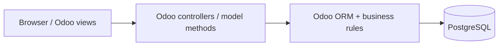
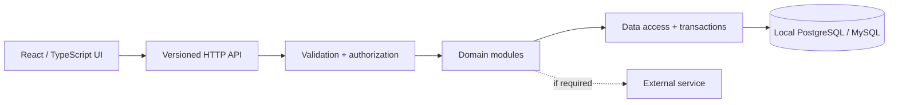
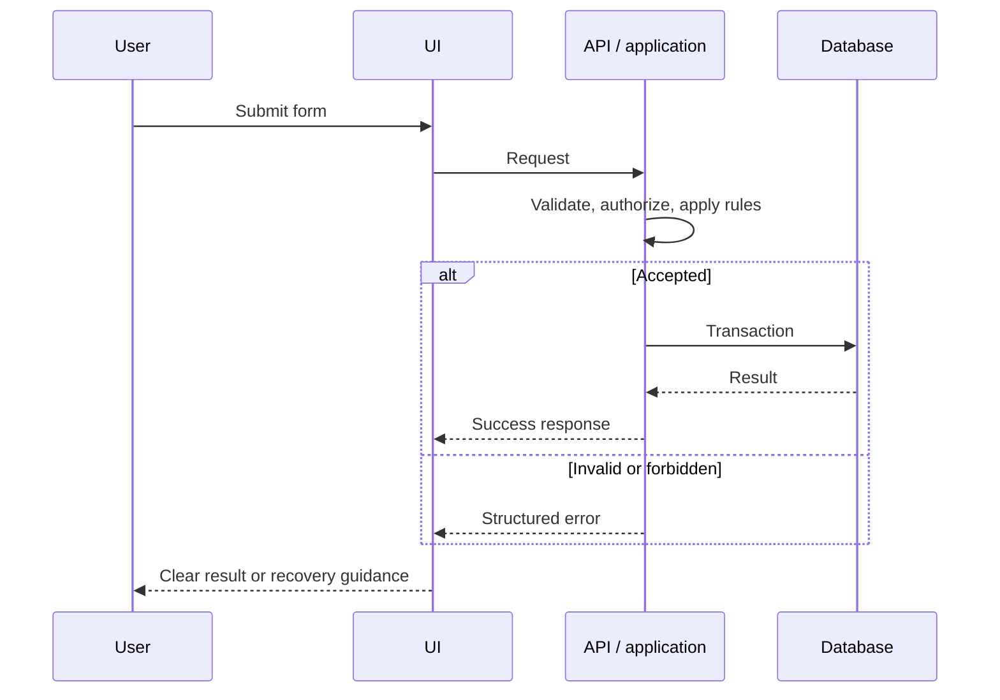

# System Architecture — Decision-Ready Blueprint

**Status:** Proposed. No implemented system or official domain is assumed.

## Principles

Optimize for a reliable eight-hour MVP: one end-to-end journey, four parallel contributors, clear contracts, real relational persistence, reproducible local setup, server-side validation/authorization, and uncomplicated debugging. Prefer a modular monolith over microservices unless the official challenge requires otherwise.

## Decision tree

1. **Odoo-native required?** Use the specified Odoo version and the standard module architecture (manifest, models, XML views, security, controllers as appropriate, ORM and PostgreSQL).
2. **External application permitted?** Evaluate a React/TypeScript/Vite frontend, a FastAPI/Pydantic backend and locally runnable PostgreSQL or MySQL.
3. **Odoo plus external integration required?** Adopt a hybrid only with explicit record ownership, authorization, failure/retry strategy and available integration time.
4. **Requirements ambiguous?** Do not finalize a stack; verify against official organizer instructions.

## Candidate A — Odoo-native

Enforce access rights and record rules. Do not bypass the ORM with unsafe database writes.

## Candidate B — Standalone modular application

Browser code never contains service credentials. Keep domain logic separate from UI and storage. Use one primary relational database; avoid direct browser-to-database access unless an approved, fully protected managed backend explicitly warrants it.

## Boundaries

| Layer | Responsibilities |
|---|---|
| UI | Accessible interactions, client-side form feedback, loading and error states |
| Controller/API | Input validation, user/role authorization, documented HTTP errors |
| Domain | Business workflows, invariants and transaction intent |
| Persistence | Constraints, transactions, migrations, indexed queries |
| Adapters | External requests, timeouts, safe retries and failure mapping |

## Proposed request sequence

These are conceptual flows, not evidence of implemented components.

## Quality and delivery gates

- Validate inputs and permissions at the trusted boundary; use parameterized queries/ORM.
- Define foreign keys, uniqueness and transactional behavior for the actual domain.
- Test the happy path, one negative path, a data-integrity rule and a clean startup.
- Plan synthetic seeds/reset procedures; do not log credentials or sensitive records.
- Choose deployment only after verifying compatible runtime and database access.
- Record implementation commands, versions and outcomes only after running them.

## Risks

| Risk | Mitigation |
|---|---|
| Incorrect assumption about Odoo requirements | Confirm official challenge before coding |
| Database setup delays | Choose the smallest tested local option |
| API/schema drift among team members | Freeze initial contracts, review changes together |
| Different branch revisions | Coordinate safe merges; no resets or force pushes |
| Demo dependency outages | Minimize external services; handle visible failures |
| Submission fails due to branch/video | Consolidate and verify well before deadline |

Record the final design and rationale in [DECISIONS.md](DECISIONS.md).
