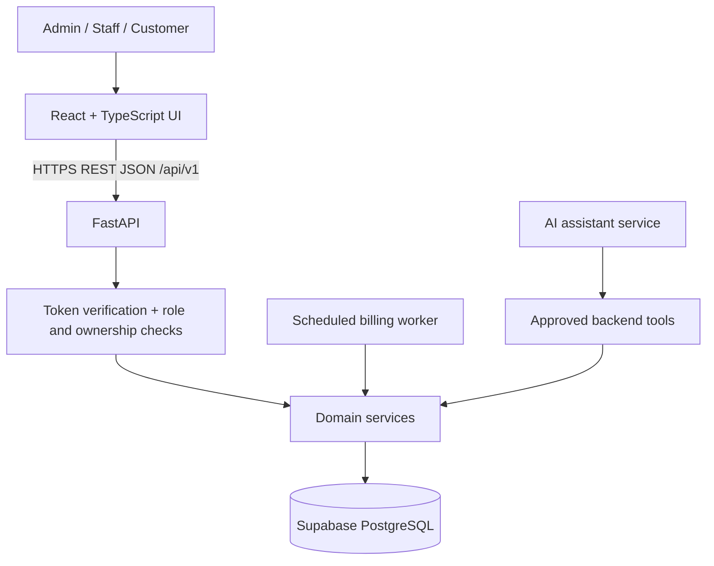

# System Architecture

**Target architecture:** modular monolith with React frontend, FastAPI backend, and Supabase PostgreSQL. This is the team's shared target design, not a claim that these components are already implemented.

## Stack

- React + TypeScript + Vite
- Tailwind CSS + shadcn/ui
- React Hook Form + Zod; TanStack Query
- Python + FastAPI + Pydantic
- Supabase Auth and Supabase PostgreSQL
- SQL migrations under `supabase/migrations/`
- Pytest and Vitest

## Logical architecture



## Responsibilities

| Component | Owns | Must not own |
|---|---|---|
| React frontend | Presentation, forms, navigation, loading/error states | Trusted authorization, financial totals, billing rules, secrets |
| FastAPI routes | HTTP parsing, authentication verification, permission checks, response schemas | Duplicated UI-only business rules |
| Domain services | Subscription lifecycle, prices, taxes, discounts, quotations, invoice/payment workflows | Direct coupling to a particular UI component |
| Persistence/repositories | Database reads/writes, transactions and query boundaries | User-facing presentation |
| Supabase PostgreSQL | Durable records, relationships, constraints, indexes, applicable RLS | Undocumented business behavior |
| Billing worker | Find due subscriptions and invoke idempotent billing services | A second implementation of invoice calculation |
| AI adapter | Translate requests into a limited set of approved tool calls and explain results | Arbitrary SQL, permission decisions, invented data |

## Request flow

1. Browser sends a typed request to FastAPI.
2. FastAPI validates the request and verifies the Supabase Auth token.
3. Backend checks the role and ownership against trusted data.
4. Domain service calculates the result and performs an appropriate transaction.
5. Backend returns a documented response or structured error.
6. Frontend updates its state and displays a clear result.

## Billing safety

- One shared calculation path for interactive and scheduled invoice creation.
- Persist the subscription and billing period on each recurring invoice.
- Enforce a database uniqueness constraint on the subscription/billing-period pair.
- Use transaction-safe writes and idempotency for retries.
- Keep invoice lifecycle separate from payment records.
- Record actor and timestamps for important changes.
- Do not call an invoice “paid” merely because a payment form was submitted; reconcile recorded payments with the invoice balance.

## AI boundary

```text
Chat UI -> FastAPI assistant endpoint -> intent/parameter extraction
       -> approved domain tool -> authorization + validated database query
       -> grounded result -> assistant explanation
```

Start with configured-plan recommendations and a small number of read-only business queries. The assistant must not invent catalog items, pricing, customer records, or permissions. Mutating actions require backend permission checks and explicit confirmation.

## Performance and reliability

- Index actual filters and join paths; use pagination.
- Avoid N+1 queries and load only required columns.
- Keep API work synchronous and simple where possible; use a scheduled worker for recurring billing.
- Target under two seconds for normal pages with thousands of records, then measure with realistic seeded data rather than claiming performance without a test.
- Keep external services optional for the core demo and show recoverable errors.

## Mandatory decision gate

Verify the official hackathon rules before relying on a standalone architecture. If a native Odoo module is mandatory, update this design and the decision register before implementation. Do not add Odoo and FastAPI as competing business backends without a documented integration need.
